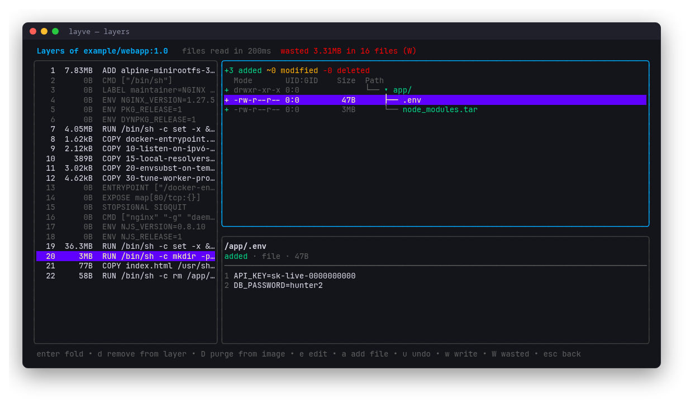
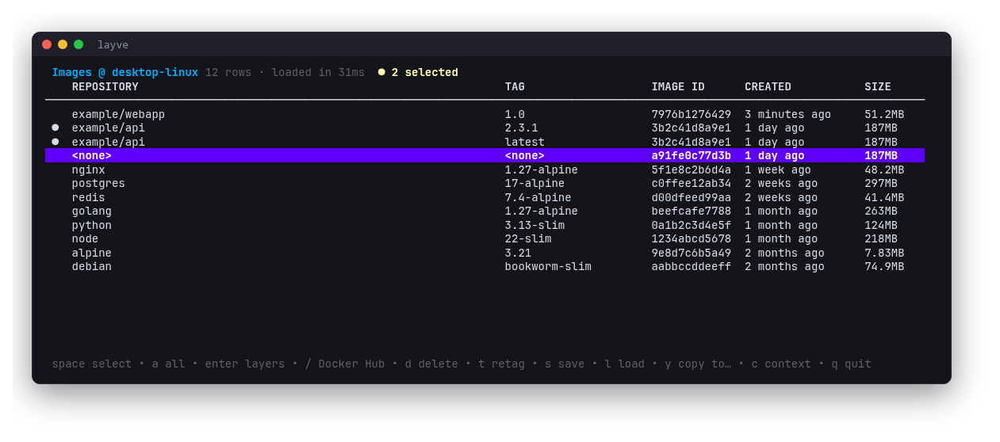
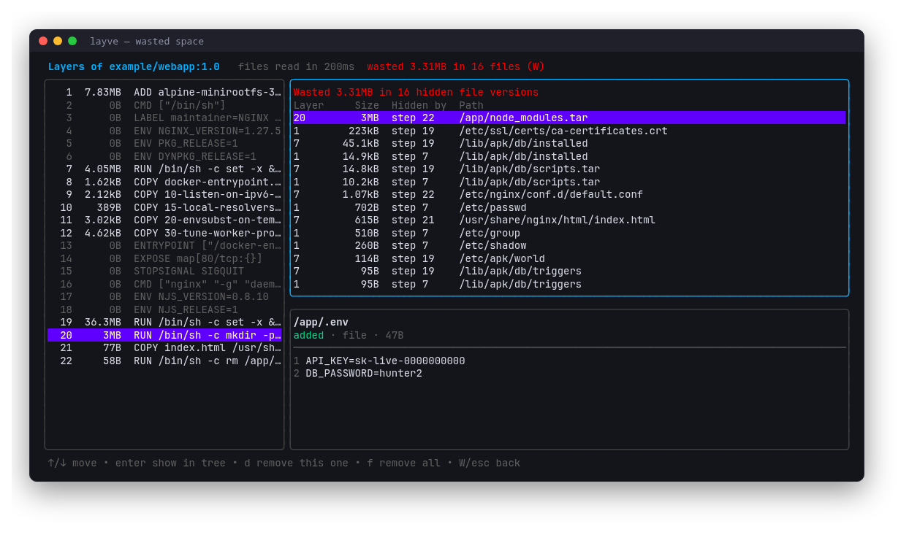
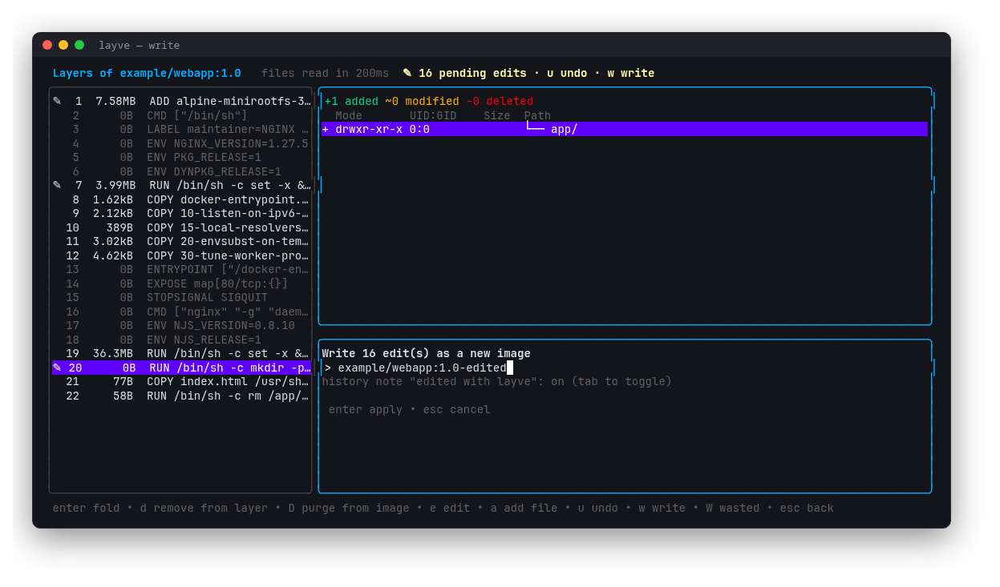

# layve

[](https://github.com/AOzhogin/layve/actions/workflows/ci.yml)
[](LICENSE)

**Wash out what's buried in Docker image layers.**

layve is a terminal UI that shows what every layer of an image really
contains, finds space wasted on files that later layers hide, and lets you fix
it — drop or merge layers, remove, edit or add files — without rebuilding the
image. The same fixes are available as commands, to drop into a CI pipeline
between `docker build` and `docker push`.



## Why

A common mistake: *"I'll just copy the new config in a later layer, and the old
one is gone."* It isn't. Every layer is stored as is, so the old config — or the
`.env` with an API key that a later `RUN rm` "deleted" — still ships with the
image and takes space in every pull.

Fixing that properly means restructuring the Dockerfile and rebuilding, which is
not always possible right now and not obvious to newcomers. layve shows the
problem and repairs the image directly.

## Features

- **Browse images**: tags, IDs, age, size; select several for bulk delete
  or retag.
- **Work on other machines**: switch between Docker contexts, including
  `ssh://` ones, and copy images between machines in either direction.
- **Find images on Docker Hub**: search, pick a tag and the platform
  (`linux/arm64`, `linux/arm/v7`, …) and pull it into the current context.
- **Save and load archives**: write images to `.tar` / `.tar.gz` files and load
  them back — also to and from remote machines.
- **Inspect layers**: the command behind each step, a collapsible file tree with
  changes highlighted (`+` added, `~` modified, `-` deleted), permissions,
  owners, sizes, where symlinks point (and which are broken), hard links, and a
  preview of text files.
- **Find wasted space**: file versions kept in lower layers although a later
  layer overwrites or deletes them; remove all of them with one key.
- **Edit the image**:
  - drop a layer, or merge adjacent layers into one;
  - remove a file from one layer (the lower version shows through again);
  - purge a path from every layer, e.g. a leaked secret;
  - edit a text file in your `$EDITOR`, or add a file from disk.
- **Scriptable**: `inspect`, `check` and `fix` commands with JSON output and
  exit codes for CI.
- **Safe by default**: edits are previewed before anything is written, can be
  undone, and are saved as a **new** image; the original stays untouched.
  Layers you did not change keep their digests, so registries reuse them on push.

## Install

Requirements: access to a Docker daemon — the local socket, `DOCKER_HOST` or
any Docker context.

**Prebuilt binaries and packages** for Linux, macOS and Windows (amd64,
arm64) are on the [releases page](https://github.com/AOzhogin/layve/releases):

```sh
# Debian, Ubuntu
sudo apt install ./layve_<version>_amd64.deb
# Fedora, RHEL
sudo dnf install ./layve-<version>-1.x86_64.rpm
# Alpine
sudo apk add --allow-untrusted ./layve_<version>_x86_64.apk
# Anything else: unpack the archive and put layve on your PATH
tar -xzf layve_<version>_linux_amd64.tar.gz layve
```

Every release ships `checksums.txt` signed with [cosign](https://docs.sigstore.dev)
(keyless, tied to this repository's release workflow), an SPDX SBOM for each
file and GitHub build provenance. To verify a download:

```sh
cosign verify-blob --bundle checksums.txt.sigstore.json \
  --certificate-identity-regexp 'https://github.com/AOzhogin/layve/' \
  --certificate-oidc-issuer https://token.actions.githubusercontent.com \
  checksums.txt
sha256sum --ignore-missing -c checksums.txt
gh attestation verify layve_<version>_linux_amd64.tar.gz --repo AOzhogin/layve
```

**With Go** (1.27 or newer):

```sh
go install github.com/AOzhogin/layve/cmd/layve@latest
```

**From source:**

```sh
git clone https://github.com/AOzhogin/layve.git
cd layve
make build        # bin/layve
```

## Usage

```sh
layve [--context NAME] [--no-mark]          # interactive UI
layve inspect|check|fix IMAGE [flags]      # commands, see below
```

### Images



| Key | Action |
|---|---|
| `↑` `↓` / `k` `j`, `pgup` `pgdn`, `g` `G` | Move |
| `space` | Select / unselect the image under the cursor |
| `a` | Select all (again to unselect) |
| `esc` | Clear the selection |
| `enter` | Open the layers of the image |
| `d` / `D` | Delete selected images (or the one under the cursor) / force delete |
| `t` | Retag: one image takes a full `repo:tag`, several take just a new tag |
| `/` | Search Docker Hub and pull an image |
| `s` | Save selected images (or the one under the cursor) to a file; `.tar.gz` / `.tgz` compresses |
| `l` | Load images from a `docker save` file (`.tar`, `.tar.gz`, …) |
| `y` | Copy selected images (or the one under the cursor) to another Docker context |
| `c` | Switch Docker context |
| `r` | Refresh |
| `q`, `ctrl+c` | Quit |

Each row is a tag, so deleting a row removes that tag; the image itself goes
away with its last tag, exactly like `docker rmi`.

### Layers

The screen has three panes: layers on the left, the file tree of the selected
layer at the top right and details of the selected file below it. `tab` and
`shift+tab` move between panes.

Opening an image streams it out of Docker once; for a 700 MB image this takes
about two seconds, most of it Docker preparing the export. The list of layers
is shown right away.

| Pane | Key | Action |
|---|---|---|
| Layers | `space` | Mark a layer |
| | `x` | Drop marked layers (or the current one); warns if later layers touch their files |
| | `m` | Merge marked layers and everything between them into one |
| Files | `enter` / `space` | Fold / unfold a directory |
| | `←` `→` | Collapse / expand; `←` on a file jumps to its directory |
| | `E` / `C` | Expand / collapse everything |
| | `d` | Remove the path from this layer only |
| | `D` | Purge the path from every layer |
| | `e` | Edit a text file (up to 64 kB) in `$VISUAL` / `$EDITOR` (default `vi`) |
| | `a` | Add a file from disk to this layer |
| Details | `↑` `↓`, `pgup` `pgdn` | Scroll the file preview |
| Any | `W` | Show wasted space |
| | `u` / `U` | Undo the last edit / all edits |
| | `w` | Write the edited image |
| | `esc` | Back (asks before discarding pending edits) |

Edited layers are marked with `✎`, merged ones with `[N merged]`. Steps that
only change metadata (`ENV`, `CMD`, `LABEL`, …) are greyed out: they have no
files and cannot be dropped.

### Wasted space



`W` lists every hidden file version, largest first, with the layer holding it
and the step that hides it. `enter` shows the file in the tree, `d` removes one
entry, `f` removes them all. The visible contents of the image do not change.

### Writing the result



`w` asks for the new tag (`repo:tag-edited` by default). Writing exports the
image, rebuilds only the changed layers and loads the result back into Docker;
you return to the image list with the new image in it.

By default every changed layer gets the history comment `edited with layve`,
so `docker history` shows what was touched. Press `tab` in the write dialog to
turn it off for this write, or start layve with `--no-mark`.

### Docker Hub

`/` opens a search on Docker Hub. Pick a repository (`✓` marks official
images) to see its most recently pushed tags with the platforms each one is
built for and its size on your platform; type in the filter box to find older
versions. Pick a tag, then a platform — the machine's own platform is
preselected — and layve pulls it into the current context.

Pulling for another architecture is how you prepare images for machines you
cannot reach a registry from: pull `linux/arm64`, then `s` to save it to a file
or `y` to copy it to that machine.

### Docker contexts and remote machines

layve uses the contexts of the `docker` CLI (`docker context ls`). The title
shows where you are, e.g. `Images @ prod`; everything — listing, deleting,
retagging, inspecting and editing — happens on that machine.

- `c` switches context. It only affects layve; the CLI's current context is
  left alone.
- `y` copies the selected images to another context: `docker save` on one
  side is streamed straight into `docker load` on the other, with no temporary
  files. Tags are kept; an untagged image is copied by ID. Existing tags on the
  target are overwritten, as with `docker load`.

Contexts may be `unix://`, `tcp://` (with the TLS material stored in the
context) or `ssh://`. For `ssh://` layve does what the `docker` CLI does: it
runs `ssh … docker system dial-stdio` with your system `ssh`, so
`~/.ssh/config`, agents and known hosts all apply, and the remote machine needs
the `docker` CLI installed.

ssh runs with `BatchMode=yes`, because a full-screen UI cannot show a password
or host-key prompt: use key or agent authentication, and connect once with
plain `ssh` to accept a new host key.

```sh
docker context create prod --docker "host=ssh://deploy@prod.example.com"
layve --context prod
```

Inspecting and editing a remote image transfers it: it is exported to your
machine, the changed layers are rebuilt locally and the result is loaded back.
Fine on a local network, slow for big images over a slow link.

## Commands for scripts and CI

The same engine without the UI. Flags may come before or after the image;
`layve COMMAND -h` lists them all.

```sh
layve inspect IMAGE [--all] [--json]
layve check   IMAGE [--max-wasted SIZE] [--max-layers N] [--json]
layve fix     IMAGE [--wasted] [--purge PATH]... [--squash | --merge A-B]...
                     [--drop N]... [-o TAG] [--dry-run] [--no-mark] [--json]
```

All commands take `--context NAME` and work on remote machines too.

**`inspect`** prints the steps with their sizes and the largest wasted files
(`--all` for every one).

**`check`** fails when the image wastes more than `--max-wasted` (sizes like
`10MB`, `512KiB`, `0`) or has more layers than `--max-layers`.

**`fix`** edits the image:

| Flag | Effect |
|---|---|
| `--wasted` | Remove file versions hidden by later layers |
| `--purge PATH` | Remove a path from every layer, e.g. `--purge /root/.npmrc` (repeatable) |
| `--squash` | Merge all layers into one |
| `--merge A-B` | Merge the layers of steps A to B (repeatable) |
| `--drop N` | Drop the layer of step N (repeatable) |
| `-o TAG` | Write the result as TAG. **Without it, the image's own tag is overwritten** so the step fits between build and push; the previous image stays in Docker untagged, and its ID is printed |
| `--dry-run` | Show what would change, write nothing |
| `--no-mark` | Do not add `edited with layve` to the history |

Edits are applied in a fixed order whatever the order of the flags: merges and
drops (step numbers as shown by `inspect`), then purges, then `--wasted`,
computed on the result. Step numbers change whenever the Dockerfile does, so
prefer `--wasted` and `--purge` in pipelines.

Exit codes: `0` success, `1` error, `2` `check` failed. `--json` prints a
machine-readable result on stdout; progress goes to stderr.

```console
$ layve fix registry.example.com/app:1.4 --wasted --purge /root/.npmrc
registry.example.com/app:1.4 (d08ce35d86b2)
  purge /root/.npmrc from image
  remove 14 hidden file versions (3.31MB)
before: 12 layers, 51.2MB, wasted 3.31MB in 15 files
after:  12 layers, 47.9MB, wasted 0B in 0 files
wrote registry.example.com/app:1.4 (1192804e289e); the previous image is kept as d08ce35d86b2
```

### GitHub Actions

```yaml
- name: Build
  run: docker build -t ghcr.io/acme/app:${{ github.sha }} .

- uses: actions/setup-go@v6
  with:
    go-version: "1.27"

- name: Clean up the image
  run: |
    go install github.com/AOzhogin/layve/cmd/layve@latest
    layve fix ghcr.io/acme/app:${{ github.sha }} --wasted --purge /root/.npmrc
    layve check ghcr.io/acme/app:${{ github.sha }} --max-wasted 5MB

- name: Push
  run: docker push ghcr.io/acme/app:${{ github.sha }}
```

### GitLab CI

```yaml
build:
  image: docker:27
  services: [docker:27-dind]
  script:
    - docker build -t "$CI_REGISTRY_IMAGE:$CI_COMMIT_SHA" .
    - ./layve fix "$CI_REGISTRY_IMAGE:$CI_COMMIT_SHA" --wasted --purge /root/.npmrc
    - ./layve check "$CI_REGISTRY_IMAGE:$CI_COMMIT_SHA" --max-wasted 5MB
    - docker push "$CI_REGISTRY_IMAGE:$CI_COMMIT_SHA"
```

(`layve` here is a binary for linux/amd64 committed to the repository or
downloaded in an earlier step.)

Treat this as a stopgap: the lasting fix is a Dockerfile that never adds the
files in the first place (multi-stage builds, `RUN --mount=type=secret`).

## Flags and environment

| | Description |
|---|---|
| `--context NAME` | Docker context to start in (or to use, for commands) |
| `--no-mark` | Do not add `edited with layve` to the history of edited layers |
| `-h`, `--help` | Show usage |
| `DOCKER_CONTEXT`, `DOCKER_HOST`, `DOCKER_CONFIG` | Which daemon to start with, chosen like the `docker` CLI does: `--context`, then `DOCKER_CONTEXT`, then `DOCKER_HOST`, then the current context in `config.json` |
| `DOCKER_TLS_VERIFY`, `DOCKER_CERT_PATH`, `DOCKER_API_VERSION` | TLS and API version for `DOCKER_HOST` |
| `LAYVE_SSH_COMMAND` | ssh client for `ssh://` contexts, e.g. `ssh -F ~/.ssh/work_config` (default `ssh`) |
| `VISUAL`, `EDITOR` | Editor for `e`; may include arguments, e.g. `code --wait` |
| `LAYVE_TRACE=<file>` | Write startup and loading timings to a file, for troubleshooting |

## Examples

**Shrink an image by removing hidden leftovers**
1. `enter` on the image; the title shows e.g. `wasted 3.31MB in 16 files (W)`.
2. `W`, then `f` — all hidden versions are removed.
3. `w`, accept or change the tag, `enter`.

**Get a leaked secret out of the image**
1. Open the image and find the file in any layer that contains it.
2. `D` purges it from every layer at once.
3. `w` to write. Then rotate the secret anyway — it has probably been pushed.

**Fix a config without rebuilding**
1. Select the layer that should hold the change and the file in the tree.
2. `e` opens it in your editor; save and quit.
3. `w` to write.

**Take an image to a machine without registry access**
1. `/`, find the image, pick the tag and the target machine's platform.
2. `space` on the images, `s`, enter `release.tar.gz`.
3. Carry the file over, then on that machine `l` and the file name — or, if
   it is reachable over ssh, skip the file: `y` and pick its context.

**Fix an image on a server and bring it home**
1. `c`, pick the server's context.
2. Open the image, fix it, `w` — the new image is written on the server.
3. `y`, pick your local context to copy the result back.

**Reduce the number of layers**
1. Mark the first and the last layer of a range with `space`.
2. `m` merges them and everything in between; the commands stay in the history.
3. `w` to write.

## How it works

layve reads images through the Docker Engine API: it streams `docker save`
once, keeping file metadata and the text of small files in memory. Edits are a
plan applied to a model of the image; the screen always shows the result of the
plan. Writing exports the image to a temporary directory, rebuilds only the
changed layer tarballs (following the OCI whiteout rules for deletions), updates
the config and manifest, and streams the archive into `docker load`. The
temporary directory is removed afterwards.

## Limitations

- **Command text stays in the history.** Removing a file does not touch the
  `created_by` of history steps: a secret written inline, as in
  `RUN echo "password=..." > file`, remains visible in `docker history` —
  `--purge` removes the file, not the command that wrote it.
- Writing needs temporary disk space about the size of the image, on the
  machine running layve — also when editing a remote image.
- Only text files up to 64 kB can be previewed and edited.
- A file that other files are hard-linked to (for example `/bin/busybox`)
  cannot be removed on its own; layve refuses and names the link that needs it.
- Dropping a layer cannot detect implicit dependencies, such as a script in a
  later layer calling a binary from the dropped one.

## Development

Everything goes through `make` (`make help` lists the targets). golangci-lint
and govulncheck are pinned as tools in `go.mod` and run with `go tool`, so Go
is all you need; Docker for the integration targets.

```sh
make build         # bin/layve: static, stripped, version from the git tag or commit
make check         # fmt-check, vet, golangci-lint, tests with -race, govulncheck
make integration   # edits nginx:1.27-alpine on the local daemon, queries Docker Hub
make smoke         # the CLI end to end, as a pipeline would use it
make remote        # round trip through a throwaway Debian host over ssh
make cross         # binaries for Linux, macOS and Windows into dist/
make fmt           # gofmt + goimports
```

Releases are made by [GoReleaser](https://goreleaser.com) from
`.goreleaser.yaml`: pushing a tag such as `v0.2.0` runs the release workflow,
which checks and tests the code, builds the archives and `deb`/`rpm`/`apk`
packages, signs the checksums, attaches SBOMs and provenance, and publishes the
release with a changelog grouped by `feat:` / `fix:` commits. Builds are
reproducible: the same tag gives the same files.

```sh
make release-check   # validate .goreleaser.yaml
make snapshot        # build everything into dist/ without publishing
git tag v0.2.0 && git push origin v0.2.0
```

`make remote` starts a Debian container with sshd and its own Docker daemon,
reached through an `ssh://` context, without touching `~/.ssh` or
`~/.docker`; to try layve against it by hand:

```sh
eval "$(test/remote/up.sh /tmp/layve-remote)"
layve --context debian
docker rm -f layve-remote
```

The code is organised as:

| Path | Contents |
|---|---|
| `cmd/layve` | Entry point |
| `internal/domain/image` | Value objects: references, layers, file changes, edit plans |
| `internal/adapter/docker` | Docker Engine API: list, tag, remove, inspect, write, copy |
| `internal/pkg/dockerctx` | Docker CLI context store |
| `internal/pkg/sshconn` | Docker API over `ssh … docker system dial-stdio` |
| `internal/pkg/dockerhub` | Docker Hub search and tags API |
| `internal/adapter/hub` | Docker Hub results as domain values |
| `internal/domain/registry` | Repositories, tags, platforms |
| `internal/pkg/imagearchive` | Reading and rewriting `docker save` archives |
| `internal/pkg/filetree` | Collapsible path tree |
| `internal/pkg/humanize` | Sizes, ages and file modes for display |
| `internal/ui` | Bubble Tea screens |
| `internal/cli` | `inspect`, `check` and `fix` commands |

## Roadmap

- Editing the command text of history steps.
- Inspecting and editing remote images on the remote machine itself, so that
  only metadata crosses the network.

## License

Copyright 2026 Anton Ozhogin.

Licensed under the [Apache License, Version 2.0](LICENSE).
